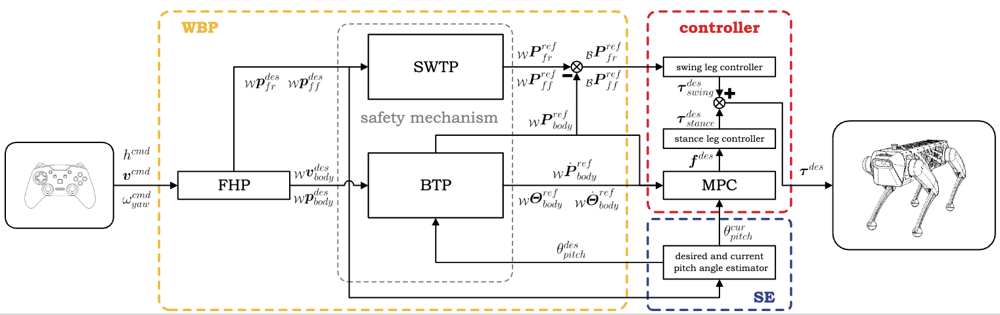
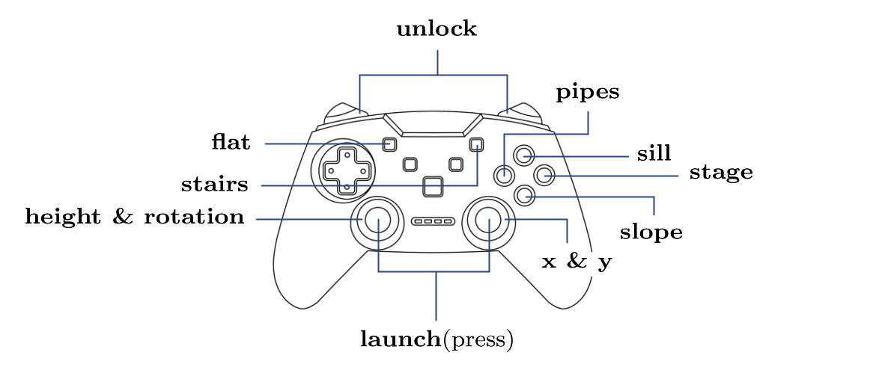

&nbsp;
<div align=center>
  
</div>

<div align="center">


</div>

## 🎙️ Introduction
PCQR (motion planning and control for quadruped robots) consists of two components for motion planning and for motion control.

<div align=center>
  
</div>

## 🧭 Initial Setup（Ubuntu）
* [Ipopt 3.12.7](https://www.coin-or.org/download/source/Ipopt/)
* [OSQP 0.4.1](https://osqp.org/)
* [RBDL](https://rbdl.github.io/)
* [Eigen](https://eigen.tuxfamily.org/index.php?title=Main_Page)
* [Webots 2021a](https://www.cyberbotics.com/doc/blog/Webots-2021-a-release)

## ✨ Run
```bash
git clone https://github.com/Technician13/PCQR.git     
cd PCQR  
```
Use CMAKE to set up the build environment and then run 'make':
```bash
mkdir build
cd build
cmake ..
make
```
Select the controller `Actiger_controller` in Webots2021a and click the button `Run`.   

## ⚙️ Configurations
* You can use a gamepad as a remote controller. 
If you want to control the robot without modifying the code, please configure the functions of your gamepad buttons as shown below. 
Otherwise, please modify the code accordingly.
<div align=center>
  
</div>

## 🎥 Results
[](https://www.youtube.com/watch?v=ZMDBQEk5xmA&list=PLXErKRgqavXHpqcdmBlYukxGkZLB1CDw-)

## 🗞️ Cite us
coming soon......
